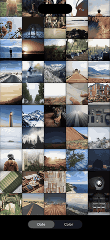

# Tessera

A photo grid for iOS, drawn with Metal. Pinch out of 100,000 photos and they become one picture.

<p align="center">
  
</p>

<p align="center"><sub>Recorded in the Simulator at 60 fps. <a href="docs/demo.mp4">Sharper video</a>.</sub></p>

## What it does

- **Scrolls and zooms at the display's refresh rate.** On an iPhone 16 Pro Max that is 120 fps at every grid size from 1 to 40 columns.
- **Never shows a blank tile.** A hard fling through the densest grid shows photos the whole way.
- **Turns the library into a picture.** Keep pinching out and the grid gives way to an overview where each photo is a few pixels wide, and together they form a sunset. Every one of the 100,000 photos appears in it exactly once.
- **Zooms back into any pixel.** Pinch in on the sun and its pixels grow into the bright photos it is made of.
- **Re-sorts by color.** Tap **Color** and all 100,000 photos fly into rainbow order.
- **Opens a photo from anywhere.** Tap a tile, or a single pixel of the overview, and it grows to full screen at its true shape. Drag it down or pinch it shut to send it back.

A two-finger tap hides the frame-rate display.

The idea started from [Shannon Potter's Metal photo grid](https://x.com/cifilter/status/2070958334690168911).

## Run it

Requires Xcode 26 or later and an iPhone on iOS 26. The script needs `jq`, which ships with recent versions of macOS.

```bash
git clone https://github.com/nemanjavlahovic/tessera.git
cd tessera
scripts/fetch-photos.sh
open Tessera.xcodeproj
```

`fetch-photos.sh` downloads about 1,000 photos (roughly 235 MB) from [Lorem Picsum](https://picsum.photos) into `Photos/`, which is not checked in. The app repeats them to fill a library of 100,000.

In Xcode, choose your own team under Signing & Capabilities, then run on a device. The Simulator works, but it is capped at 60 fps and tells you little about how the app feels.

The project file is generated from `project.yml` with [XcodeGen](https://github.com/yonaskolb/XcodeGen). Run `xcodegen generate` after adding or removing source files.

## How it works

### Tiles are placed on the GPU

Every tile is an instance of one quad. The vertex shader works out where it goes from a description of the grid (column count, cell size, scroll offset) and a lookup table that says which photo sits in which cell. Each frame the CPU writes those few numbers and a table of about 1,000 texture entries. It never touches individual tiles.

Scrolling and zooming submit only the cells that are on screen. Re-sorting submits all 100,000 items, and the shader discards the ones that are off screen at both ends of the move.

### No blank tiles

A 128 px copy of every photo is loaded into a single mipmapped texture array at launch and stays there. Sharper copies (384 px and 1024 px) are decoded on background threads as tiles grow large enough to need them, uploaded into fixed pools of texture slots, and faded in over the thumbnail. The least recently used slot is replaced first, and never one that a frame still being drawn might read.

### Zooming between column counts

Sliding each tile from its place in an n-column grid to its place in an n + 1-column grid looks wrong: tiles at the end of a row cross the whole screen to wrap to the next one, and the grid shears apart. Tessera draws both grids instead, as rigid sheets at the same in-between cell size, and crossfades one into the other through the middle of the step.

Both sheets are positioned so the photo under your fingers stays under them and stays in its column. A sheet that is momentarily narrower than the screen draws extra columns past its own edge, showing photos from the neighboring rows, so the screen edge never goes black.

### The overview

Past 40 columns the library is laid out as a plane 216 tiles wide and 463 tall, sized to fit the screen. Pinching scales that plane around your fingers, so the pixels of the picture grow into square photos. When they reach the size of a 40-column cell, the plane crossfades into the scrolling grid with the same photo held in place.

### The picture

The sunset is generated in code (`Picture.swift`), so no image rights are involved. To build it, cells are visited in random order and each takes the photo closest to its target color that still has unused copies. Before matching, the target's brightness is remapped to the brightness the library actually has, so the picture never asks for more dark or light photos than exist.

Because every photo is used exactly once, going from the timeline to the picture is a true rearrangement of the library.

### Re-sorting

Each item knows its cell in both arrangements. The change spreads as a ripple from the control that was tapped. Tiles that are on screen before and after fly to their new place, growing slightly while they travel. Tiles that only leave or only arrive drift a short way and fade. In the overview, where every tile travels at once, the two arrangements also crossfade underneath so the screen stays covered.

With Reduce Motion on, a re-sort is a plain crossfade.

### The photo view

Tapping a tile decodes the full photo on a background thread, then grows it from its cell on a spring. Its crop opens from the cell's square to the whole photo without stretching. A drag or pinch moves the photo directly. Letting go either returns it to its cell or settles it back in place, and a short flick down counts as a dismissal. Pinching in past one column opens the same view.

### Touch and motion

The Metal view reads raw touches, with no gesture recognizers in between, so there is no recognition delay. Scrolling uses UIScrollView's deceleration rate and rubber-band curve. Springs are critically damped and stepped with their exact solution, so motion is the same at 60 Hz, at 120 Hz, and after a dropped frame.

## Layout

```
Sources/
  App/           scene setup, view controller, overlay controls, raw-touch Metal view
  Interaction/   zoom, scroll and re-sort state; photo view; grid layouts; springs
  Library/       the mock library, its three arrangements, the generated picture
  Rendering/     renderer, texture tiers, photo-view texture, shaders
scripts/
  fetch-photos.sh
```

## Credits

Photos are from [Unsplash](https://unsplash.com), served by [Lorem Picsum](https://picsum.photos), under the [Unsplash License](https://unsplash.com/license). The fetch script writes a credit for each photo to `Photos/CREDITS.md`. No photos are redistributed in this repository.
